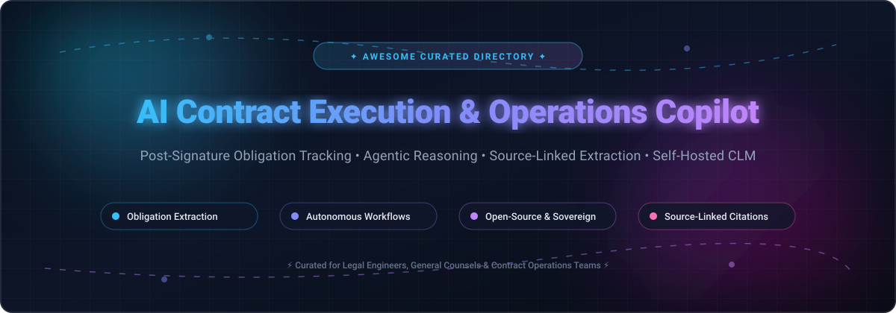

# Awesome AI Contract Execution & Operations Copilot 📜🤖

<p align="center">
  
</p>

<p align="center">
  <a href="https://github.com/ishandutta2007/Awesome-Awesome-Awesome"></a>
  <a href="https://discord.gg/jc4xtF58Ve"></a>
  <a href="https://github.com/ishandutta2007/Awesome-AI-Contract-Execution-Operations-Copilot/stargazers"></a>
  <a href="https://github.com/ishandutta2007/Awesome-AI-Contract-Execution-Operations-Copilot/network/members"></a>
  <a href="https://github.com/ishandutta2007/Awesome-AI-Contract-Execution-Operations-Copilot/issues"></a>
  <a href="https://github.com/ishandutta2007/Awesome-AI-Contract-Execution-Operations-Copilot/blob/main/LICENSE"></a>
  <a href="https://github.com/ishandutta2007"></a>
</p>

---

## 🌟 Overview & Mission

**Awesome AI Contract Execution & Operations Copilot** is a curated index of enterprise **SaaS platforms** and **open-source repositories** advancing the frontier of **Contract Lifecycle Management (CLM)**, **agentic contract reasoning**, **post-signature obligation extraction**, and **self-hosted legal AI**. 

Modern contract operations require moving beyond passive cloud document storage. These state-of-the-art tools turn unstructured agreements and PDF portfolios into structured, actionable, and verifiable operational workflows—tracking post-signature milestones, surfacing renewal terms, preventing revenue leakage, and executing approvals with autonomous AI agents.

> 💡 **Core Focus Areas**: Post-Signature Obligation Tracking • Agentic Workflow Orchestration • Source-Linked Evidence & Citations • Multi-Agent Legal Reasoning • Self-Hosted & Sovereign CLM Architectures.

---

## 📑 Table of Contents

- [📊 Sector Overview & Market Dynamics](#-sector-overview--market-dynamics)
- [🏢 SaaS/Hosted Platforms](#-saashosted-platforms)
- [💻 Open-Source GitHub Projects](#-open-source-github-projects)
- [🛠️ Composable Stack Recommendations](#️-composable-stack-recommendations)
- [🤝 How to Contribute](#-how-to-contribute)
- [💖 Support & Sponsorship](#-support--sponsorship)
- [📈 Star History](#-star-history)
- [⚠️ Disclaimer](#️-disclaimer)

---

## 📊 Sector Overview & Market Dynamics

The global **Contract Lifecycle Management (CLM)** and AI contract operations sector is currently valued between **$1.8 Billion and $2.1 Billion** and is accelerating at a Compound Annual Growth Rate (**CAGR of ~12%**), projected to surpass **$5 Billion+ by the mid-2030s**. 

The sector exhibits **moderate fragmentation**:
- **Low Concentration Ratio**: The top 5 market players collectively command approximately **28% to 35%** of global revenues, leaving significant room for specialized legal-tech solutions.
- **Ecosystem Scale**: Across global, regional, and niche jurisdictions, there are over **150+ active vendors**.
- **Market Consolidation Pressures**: Major technology leaders and legacy enterprise suites continue aggressive M&A consolidation—exemplified by Thomson Reuters acquiring Casetext ($650M), Workday acquiring Evisort ($311M), and DocuSign acquiring Lexion ($165M)—while generative AI legal leaders like Harvey AI ($15.5B valuation) and Icertis ($5.0B valuation) attract unprecedented private capital to build end-to-end agentic platforms.

---

## 🏢 SaaS/Hosted Platforms

The table below summarizes leading commercial platforms, sorted by **Company Scale (Valuation / Revenue / M&A consideration)** in descending order:

| Platform | Company Scale (Valuation / Revenue) | Pricing | Free Tier / Trial Limits | Description & Best For | Trade-offs |
| :--- | :--- | :--- | :--- | :--- | :--- |
| [**Harvey AI**](https://www.harvey.ai/) | **$15.5B valuation** (~$400M+ ARR) | ~$1,000–$1,200 / user / month (min. 20–25 seats; starting floor ~$288K–$360K / year) | No free tier; demo / sales-assisted PoC only upon qualification | Generative AI platform for deep contract reasoning, clause drafting, and portfolio search; best for top law firms and legal teams | No native execution/CLM layer (approvals, e-sign); requires pairing with tools like Ironclad |
| [**Icertis Vera Copilot**](https://www.icertis.com/) | **$5.0B valuation** (~$300M–$350M ARR) | ~$48,000–$100,000+ / year base subscription (typically $150–$350 / user / month equivalent) | No free tier or public free trial; sales-assisted enterprise demo/PoC only | Enterprise contract intelligence control plane with agentic obligation execution (Vera Operate); deeply embedded in SAP, Microsoft, and Salesforce | Steep six-figure initial commitments; complex implementation and onboarding cycles |
| [**Ironclad AI**](https://ironcladapp.com/) | **$3.2B valuation** (~$200M+ ARR) | ~$50,000–$60,000+ / year starting tier (approx. $200–$600 / user / month equivalent) | No free tier or self-serve trial; custom sales-led demo/PoC only | Workflow-first CLM with AI assistance, obligation tracking, and Harvey integration; best for scalable legal ops approval chains | AI reasoning is less native compared to Harvey; dependency on external partnerships |
| [**Casetext CoCounsel**](https://casetext.com/) | **$650M acquisition** (Thomson Reuters) | ~$340–$630+ / user / month (Essentials tier; Legal suite upwards of $1,600+ / month) | No permanent free tier; time-limited sales-provisioned evaluation trial upon request | AI legal research, contract review, and document analysis integrated into Westlaw / Practical Law ecosystems | Transitioned into Thomson Reuters enterprise bundles; standalone product no longer available |
| [**ContractPodAi Leah**](https://contractpodai.com/) | **~$250M–$700M valuation** (~$40M–$57M ARR) | ~$50,000–$65,000 / year starting platform fee (unlimited user tier + AI add-on) | No free tier or public trial; sales consultation and custom enterprise demo only | AI-native CLM with intake portal ("Legal Front Door"), automated redlining, and obligation tracking | Substantial first-year setup and workflow configuration investment |
| [**Luminance**](https://www.luminance.com/) | **~$400M valuation** (~$30M ARR, $165M raised) | ~$40,000–$60,000+ / year starting tier (volume/capacity-based document licensing) | No free tier or self-serve trial; request-only corporate demonstration and trial | Proprietary legal LLM specializing in portfolio-wide contract analysis, due diligence, and automated negotiation | Pricing scales quickly with contract repository size; less focused on mid-market self-serve teams |
| [**Spellbook**](https://www.spellbook.legal/) | **$350M valuation** (~$100M ARR) | ~$50–$350+ / user / month (tailored quote by team seat count & add-on agents) | **7-day free trial** (access to Word add-in drafting, redlining, and playbooks; no credit card required) | AI contract drafting, review, and playbook benchmarking directly inside Microsoft Word | Primarily focused on drafting and pre-signature review; not a comprehensive post-signature CLM |
| [**Evisort AI**](https://www.evisort.com/) | **$311M acquisition** (Workday) | ~$30,000–$60,000 / year starting tier (covering 500–2,000 contracts) | No free tier or self-serve trial; demo and enterprise proof-of-concept through sales | AI contract intelligence and post-signature obligation tracking with analytics; integrated into Workday CLM | Primarily analytics- and extraction-driven; requires Workday ecosystem alignment post-acquisition |
| [**Lexion AI**](https://www.lexion.ai/) | **$165M acquisition** (DocuSign) | ~$15,000–$25,000 / year starting tier (approx. $1,500–$2,100 / month equivalent) | No free tier or self-serve trial; sales demo and guided evaluation only | Lightweight, accessible AI contract repository and workflow management for mid-market teams | Now part of DocuSign; advanced enterprise features require higher DocuSign tiers |
| [**Robin AI**](https://www.robinai.com/) | **~$70M+ raised / ~$10M ARR** | Free plan available; paid tiers quote-based (custom volume/seat pricing) | **Free Forever Plan** (capped at 1 user and ~10 AI messages/queries per day) | AI contract review and redlining assistant powered by custom legal models; best for rapid clause checks | Free tier limited to basic exploratory queries; advanced playbook automation requires paid plans |

---

## 💻 Open-Source GitHub Projects

Open-source and self-hosted tools provide data sovereignty, private infrastructure deployments, zero vendor lock-in, and full control over sensitive contractual data.

Repositories below are sorted strictly by **GitHub Stars_Count (descending)**:

| Project | GitHub_Stars | Focus & License | Tech Stack | Highlights |
| :--- | :--- | :--- | :--- | :--- |
| [**OpenContracts**](https://github.com/Open-Source-Legal/OpenContracts) | [](https://github.com/Open-Source-Legal/OpenContracts/stargazers) | **Document Intelligence & Citation Network** (MIT) | Python, Django, React, Celery, MCP | Turns contract libraries into searchable citation knowledge graphs. Built-in Model Context Protocol (MCP) server for agentic IDEs, human-in-the-loop annotations, and structured multi-document extraction. |
| [**CUAD (Contract Understanding Atticus Dataset)**](https://github.com/TheAtticusProject/cuad) | [](https://github.com/TheAtticusProject/cuad/stargazers) | **Legal Contract Clause Benchmark** (CC BY 4.0 / Code Apache-2.0) | Python, PyTorch, HuggingFace, Transformers | Foundational open-source benchmark and model checkpoints fine-tuned for extracting 41 distinct commercial contract clause types and legal risk conditions. |
| [**Ally Legal Assistant**](https://github.com/Azure-Samples/ally-legal-assistant) | [](https://github.com/Azure-Samples/ally-legal-assistant/stargazers) | **Word AI Contract Copilot** (MIT) | TypeScript, Office.js, Azure OpenAI, Python | Reference Microsoft Word legal plugin for automated contract review, clause-level risk assessments, redline proposals, and chat over agreements. |
| [**draftLegal**](https://github.com/AniketTati/draft-legal) | [](https://github.com/AniketTati/draft-legal/stargazers) | **Full AI-Native CLM Platform** (Source-Available) | Node.js, Python, React, PostgreSQL, Elasticsearch, pgvector | Complete Ironclad + Harvey open-source alternative. Features 8 specialist agents (review, draft, redline, approvals), hybrid vector search, e-signatures, and post-signature obligation tracking. |
| [**ContractSpark**](https://github.com/ICodingStack/ContractSpark) | [](https://github.com/ICodingStack/ContractSpark/stargazers) | **AI Contract Generation** (MIT) | TypeScript, React, Tailwind, Claude API | Free browser-based AI legal document builder with live preview, customizable contract templates, offline mode, and instant PDF export. |
| [**Aakd**](https://github.com/aaked-app/aakd) | [](https://github.com/aaked-app/aakd/stargazers) | **Source-Linked Obligation Operations** (AGPL-3.0) | TypeScript, PostgreSQL, Redis, MinIO, Ollama | Focused post-signature obligation register. Extracts clauses and commitments with page-level citations, human review verification, approval chains, and local Ollama inference. |
| [**Marai**](https://github.com/ProgrammingNotJustCoding/marai) | [](https://github.com/ProgrammingNotJustCoding/marai/stargazers) | **Legal Workflow & Contract System** (MIT) | Python, FastAPI, React | Automated contract management workflow engine for legal document generation, approvals, and portfolio management. |
| [**Terms AI**](https://github.com/nkasuku/terms-ai) | [](https://github.com/nkasuku/terms-ai/stargazers) | **AI Contract Risk Reviewer** (MIT) | TypeScript, Next.js, OpenAI API | Legal review tool analyzing agreement risk levels (High/Medium/Low), producing executive summaries and redline improvement suggestions. |
| [**signcraft**](https://github.com/Steviewonders99/signcraft) | [](https://github.com/Steviewonders99/signcraft/stargazers) | **AI E-Signature & Review** (Open-Source) | TypeScript, Next.js, Node.js | Free, privacy-respecting alternative to DocuSign and PandaDoc with built-in AI clause analysis during execution. |
| [**ContractsPulse**](https://github.com/aayushus/ContractsPulse) | [](https://github.com/aayushus/ContractsPulse/stargazers) | **Contract Risk & Warning Platform** (MIT) | SvelteKit, FastAPI, Pydantic-AI, Python | Self-hosted contract intelligence platform delivering clause risk analysis, plain-English warnings, and policy compliance verification. |
| [**Multi-Agent Contract Platform**](https://github.com/Fan-Luo/multi-agent-contract-platform) | [](https://github.com/Fan-Luo/multi-agent-contract-platform/stargazers) | **Agentic Contract Verification** (Apache-2.0) | Python, Multi-Agent Framework, NLP | Layout-aware ingestion, NLI-based semantic contract diffing, DLP controls, and policy-grounded multi-agent risk verification. |
| [**contract-vault**](https://github.com/DrBaher/contract-vault-cli) | [](https://github.com/DrBaher/contract-vault-cli/stargazers) | **Post-Signature Obligation CLI** (MIT) | Python (Zero-dependency stdlib) | Git-backed register for executed contracts. Tracks renewal windows, notice deadlines, and payment schedules as an `.ics` calendar with deterministic field provenance. |

---

## 🛠️ Composable Stack Recommendations

For engineering teams constructing internal legal infrastructure with complete data sovereignty:

```
┌────────────────────────────────────────────────────────┐
│             AI Front-End & Drafting                    │
│      Ally Legal Assistant (Word) / ContractSpark       │
└──────────────────────────┬─────────────────────────────┘
                           │
┌──────────────────────────▼─────────────────────────────┐
│             Full Lifecycle & Agentic CLM               │
│                      draftLegal                        │
│   (Multi-Agent Review, Approvals, In-App E-Sign)       │
└──────────────────────────┬─────────────────────────────┘
                           │
┌──────────────────────────▼─────────────────────────────┐
│          Post-Signature Operations & Citations         │
│          Aakd  (Obligation & Review Register)          │
│          contract-vault (Git & Calendar Triggers)      │
└──────────────────────────┬─────────────────────────────┘
                           │
┌──────────────────────────▼─────────────────────────────┐
│      Document Intelligence & Citation Knowledge Graph  │
│          OpenContracts (MCP Server & RAG Layer)        │
│          CUAD Checkpoints (Clause Classification)      │
└────────────────────────────────────────────────────────┘
```

---

## 🤝 How to Contribute

Contributions from legal practitioners, legal operations engineers, and open-source developers are warmly welcome!

1. **Fork** this repository.
2. **Add or modify** entries in [`README.md`](file:///C:/Users/ishan/Documents/Projects/Awesome-AI-Contract-Execution-Operations-Copilot/README.md).
3. **Ensure quality**: Include official URLs, GitHub Stars_Badges linked to the repo's stargazers page, accurate licensing, exact pricing details, and objective trade-offs.
4. **Submit a Pull Request** with a brief summary of the project and why it belongs here.

---

## 💖 Support & Sponsorship

If you find this repository valuable for your legal engineering research or contract operations stack, please consider supporting the project:

- ⭐ **Star this repository** to improve discoverability.
- 🍴 **Fork and share** with colleagues in legal-tech and developer communities.
- ☕ **Sponsor the Maintainer**: Support ongoing open-source curation and development by buying a coffee via the [GitHub Sponsors Dashboard](https://github.com/sponsors/ishandutta2007)!

<p align="left">
  <a href="https://github.com/sponsors/ishandutta2007">
    
  </a>
</p>

---

## 📈 Star History

[](https://www.star-history.com/#ishandutta2007/Awesome-AI-Contract-Execution-Operations-Copilot&type=date&legend=top-left)

---

## ⚠️ Disclaimer

- This repository is a **community-curated directory** intended for informational and architectural research purposes only. It does not constitute formal legal advice.
- When deploying AI platforms over confidential legal agreements, ensure strict adherence to jurisdictional regulations (GDPR, CCPA, HIPAA, EU AI Act) and establish enterprise-grade data protection, SOC2 compliance, and encryption at rest and in transit.
